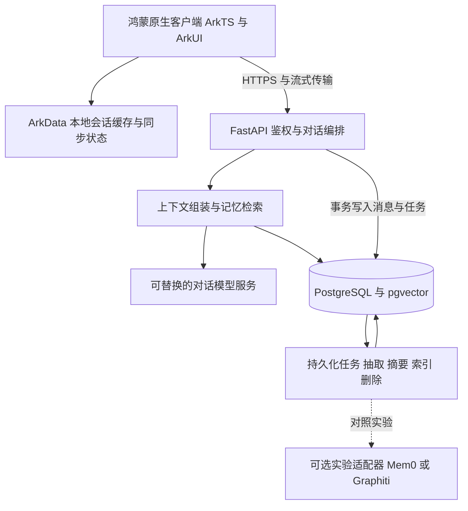

# 鸿蒙 AI 陪伴应用 GitHub 项目预研

调研日期：2026 年 11 月 1 日。目标仓库：[djw0514/emotional-robot](https://github.com/djw0514/emotional-robot)。

建议自建鸿蒙原生客户端和记忆业务层，复用开源项目的抽取、检索与交互设计。第一阶段选择 ArkTS、ArkUI、FastAPI、PostgreSQL 与 pgvector；用中文场景对比自建基础方案和 Mem0，再决定是否接入记忆引擎。复杂关系与历史状态查询出现明确需求后，再评估 Graphiti。

## 产品范围与平台选择

本项目暂按手机中的 AI 陪伴软件规划，包括稳定角色、文字或语音交流、用户偏好和共同经历的长期记忆。实体机器人控制、全天候后台监听、完全离线大模型推理暂不计入首版。

华为的原生应用开发工具链包括 DevEco Studio、ArkTS 和 ArkUI，SDK 提供数据、网络、音频和 AI 能力。建议先用官方工具创建原生工程，再逐项验证网络流式返回、本地数据与语音能力。[华为开发入口](https://developer.huawei.com/consumer/cn/develop/)

| 路线 | 适用情况 | 对本项目的建议 |
| --- | --- | --- |
| 鸿蒙原生 ArkTS 与 ArkUI | 目标手机支持原生鸿蒙应用 | 优先采用；先确认机型、系统与最低 API |
| Android 客户端 | 目标设备确认可以运行 Android 应用 | 如需兼容再建独立客户端，共享后端与接口 |
| ArkWeb 承载网页界面 | 快速验证网页角色、已有 Web 功能 | 可做局部实验，需验证音频、渲染、桥接和生命周期 |
| Flutter 等跨平台路线 | 同时支持多个平台且团队已有经验 | 另行核实鸿蒙适配分支、插件与构建链，暂不作为默认方案 |

“支持手机网页”不能作为“支持鸿蒙原生安装包”的依据。OpenHarmony 示例也需要结合商用 HarmonyOS SDK、签名和真机重新验证。

## 项目对比

下列日期为 GitHub API 查询到的**默认分支最近提交日期，按 UTC 记录**，不等同于最近一次功能更新。提交哈希与 API 字段见[状态快照](github-snapshot-2026-11-01.json)。许可证是本次选型线索，复制代码时仍需保留对应文件的声明；模型、字体和角色素材须另看各自授权。

### 鸿蒙客户端与官方示例

| 项目 | 已公开能力 | 状态与许可证 | 复用建议 |
| --- | --- | --- | --- |
| [Cube Chat](https://github.com/LongLiveY96/chatcube) | ArkTS AI 聊天客户端，支持多个模型服务商和流式对话 | 2026-06-05；MIT；README 宣布归档，API 的 archived 字段仍为 false | 最贴近客户端需求；参考 UI、服务商适配及 MVVM 目录，不依赖后续维护 |
| [HarmonyOS X Deepseek](https://github.com/SJYssr/HarmonyOS-X-Deepseek-) | ArkTS 调用 DeepSeek 的教学项目 | 2025-09-03；GitHub 识别 GPL-3.0，README 另写限制盈利等条款 | 仅作学习线索，不列为首版代码来源 |
| [华为 HarmonyOS Codelabs](https://github.com/huaweicodelabs/harmonyos-codelabs) | 华为组织发布的能力示例，含音频与数据等示例 | 2022-01-20；API 未识别标准许可证 | 多为旧工程，查概念时可参考；当前接口以华为开发文档和所选 SDK 为准 |

Cube Chat 的 README 自述鸿蒙与 API 版本要求，但本次未编译其工程，因此不据此锁定本项目的兼容下限。它的 README 与 GitHub 归档字段有差异，维护判断采用“作者已宣布停止公开更新”。[项目说明](https://github.com/LongLiveY96/chatcube/blob/main/README.md)、[MIT 文件](https://github.com/LongLiveY96/chatcube/blob/main/LICENSE)

### 长期记忆与智能体框架

| 项目 | 适合借鉴的能力 | 状态与许可证 | 本项目定位 |
| --- | --- | --- | --- |
| [Mem0](https://github.com/mem0ai/mem0) | 从交互中抽取记忆，语义、关键词与实体信号融合检索 | 2026-10-30；Apache-2.0 | 优先做同数据对照验证；保留自己的记忆生命周期 |
| [Graphiti](https://github.com/getzep/graphiti) | 动态时序知识图谱，事实有效期、关系检索与事实失效 | 2026-11-01；Apache-2.0 | 第二阶段验证人物关系和历史状态；增加图数据库与抽取成本 |
| [Letta](https://github.com/letta-ai/letta) | 有状态智能体与长期记忆的设计入口 | 2026-10-18；Apache-2.0 | 主仓库已改为入口，旧 V1 API server 在 archive 分支 |
| [Letta Code](https://github.com/letta-ai/letta-code) | 当前 Letta 实现，记忆块、Git 跟踪的上下文和后台反思 | 2026-11-01；Apache-2.0 | 参考人格与记忆块设计；整套运行时需额外评估产品耦合 |
| [LangMem](https://github.com/langchain-ai/langmem) | 对话抽取、后台整合、与 LangGraph Store 集成 | 2026-10-30；MIT | 适合已选择 LangGraph 的后端；单独建本应用不必先引入整套框架 |
| [Memobase](https://github.com/memodb-io/memobase) | 以用户画像为中心的记忆和事件组织 | 2026-01-11；Apache-2.0 | 偏好、画像 Schema 值得借鉴；维护间隔较长，先参考设计 |

**Mem0 的版本变化直接影响记忆管理设计。** 当前迁移文档说明自动抽取使用 ADD-only，不再在抽取流程内判断 UPDATE/DELETE，外部图存储集成也已从 OSS 移到 Platform。源码仍提供显式 `update`、`delete` 与 `delete_all`，所以“自动抽取只新增”不代表“不能手动删除”。偏好变更、失效和删除仍须由本项目定义并验证。[迁移文档](https://docs.mem0.ai/migration/oss-v2-to-v3)、[固定提交的 Memory 实现](https://github.com/mem0ai/mem0/blob/753496cf1435d76c3a711f3af51303f7fdcb6420/mem0/memory/main.py)

**Graphiti 更适合需要历史状态的关系问题。** 例如“现在住哪里”和“去年住哪里”需要区分事实有效时间与记录时间。其文档列出了图数据库和结构化输出要求，这会增加部署组件及模型适配工作；首版偏好记忆可以先用带版本与有效期的关系表实现。[Graphiti 说明](https://github.com/getzep/graphiti#readme)

**Letta 不能直接照旧教程接入。** 现主仓库明确将活动实现指向 `letta-code`，将 V1 API server 标为历史代码。后续若选 Letta，应重新核实当前 SDK、运行方式和数据导出，而不是继续采用旧服务端教程。[Letta 入口说明](https://github.com/letta-ai/letta/blob/main/README.md)、[当前实现](https://github.com/letta-ai/letta-code#readme)

LangMem 提供存储无关的抽取原语及 LangGraph 集成；其示例中的 `InMemoryStore` 重启会丢失数据，生产必须换成持久化存储。Memobase 则围绕用户画像和事件组织记忆，适合参考“明确画像字段 + 时间事件”的划分。[LangMem 说明](https://github.com/langchain-ai/langmem#readme)、[Memobase 说明](https://github.com/memodb-io/memobase#readme)

### AI 陪伴与角色交互

| 项目 | 可借鉴部分 | 状态与许可证 | 鸿蒙适配判断 |
| --- | --- | --- | --- |
| [AIRI](https://github.com/moeru-ai/airi) | 实时语音、Live2D、VRM、角色表现和模块化交互 | 2026-11-01；MIT | Web、桌面与移动实现可参考；本次未核实原生鸿蒙构建能力 |
| [Open LLM VTuber](https://github.com/Open-LLM-VTuber/Open-LLM-VTuber) | 语音打断、语音管线与 Live2D 角色 | 2026-05-15；LICENSE 写明代码 MIT，Live2D 示例另行授权 | 可参考后端语音编排；手机端录播、打断与渲染仍需重新适配 |
| [SillyTavern](https://github.com/SillyTavern/SillyTavern) | 角色卡、世界设定、提示词拼装和摘要交互 | release 分支 2026-09-14；AGPL-3.0 | 参考产品设计，不作为本项目默认复制来源 |

AIRI 的 README 仍将完整记忆模块列为进行中，不能因为角色表现完整就认定其记忆管理已满足本项目。Open LLM VTuber 正在规划 v2，README 也明确区分项目代码与 Live2D 示例素材的授权。[AIRI 路线图](https://github.com/moeru-ai/airi#readme)、[Open LLM VTuber 说明](https://github.com/Open-LLM-VTuber/Open-LLM-VTuber#readme)、[许可证](https://github.com/Open-LLM-VTuber/Open-LLM-VTuber/blob/main/LICENSE)

SillyTavern 的角色卡适合表达角色设定，但用户事实、临时情绪与角色虚构背景应分别管理，防止相互污染。[角色卡与功能说明](https://docs.sillytavern.app/)

### 存储与评测

| 项目 | 用途 | 状态与许可证 | 本项目采用方式 |
| --- | --- | --- | --- |
| [pgvector](https://github.com/pgvector/pgvector) | PostgreSQL 向量检索扩展 | 2026-10-31；LICENSE 为 PostgreSQL 许可文本，API 未识别标准类型 | 首版候选；让业务记录、有效期和向量共享同一数据库 |
| [LongMemEval](https://github.com/xiaowu0162/LongMemEval) | 信息抽取、多会话推理、知识更新、时间推理与拒答评测 | 2026-05-11；代码 MIT，数据另查发布条款 | 借鉴能力分类，并用固定版本测试 |
| [LoCoMo](https://github.com/snap-research/locomo) | 长对话记忆评测 | 2024-08-13；API 为 NOASSERTION | 作为补充实验；数据和评测代码的许可分别核实 |

pgvector 的近似索引与过滤条件组合可能降低召回数量，因此权限、状态和有效期过滤之外，还需测量过滤后的 Recall@K，必要时增加扫描或采用精确检索。首版数据量较小时先保留精确检索作为对照。[过滤与多租户说明](https://github.com/pgvector/pgvector#filtering)

## 推荐架构

这是针对本项目的架构建议。PostgreSQL 中的消息、事实版本、来源与删除状态构成权威记录；索引和第三方引擎是可重建的派生数据。首版不同时部署多个记忆引擎，避免同步和删除复杂度失控。

| 层次 | 首版选择 | 取舍 |
| --- | --- | --- |
| 手机 UI | ArkTS、ArkUI，Stage 模型 | 使用官方工程模板，先跑通真机 |
| 手机持久化 | ArkData 关系型数据库 | 缓存会话和同步状态，避免复制所有云端记忆 |
| 网络传输 | HTTPS，SSE 为首要验证对象，WebSocket 为备选 | 显式实现分块 UTF-8 解码、事件边界、取消与断线行为 |
| 业务 API | Python、FastAPI | 便于接入 Python 记忆组件，模型调用放在服务端 |
| 记忆存储 | PostgreSQL、pgvector、中文分词后的关键词索引 | 同库管理事务和向量；中文检索单独验收 |
| 后台任务 | PostgreSQL 任务表与独立 worker | 先减少部署组件；通过幂等键、租约和重试保证处理 |
| 语音 | 优先验证 Core Speech Kit，必要时用服务端 ASR/TTS | 按语言、机型、网络和 API 可用性决定 |
| 角色表现 | 首版静态角色或轻量 2D 表情 | Live2D 或 VRM 留到记忆和语音链路稳定后 |

鸿蒙的 Core Speech Kit 提供语音识别与文本转语音；Speech Kit 更偏向朗读、字幕等场景组件，二者不要混为一个能力。具体接口、权限及最低版本需随所选 SDK 验证。[Core Speech Kit](https://developer.huawei.com/consumer/cn/sdk/core-speech-kit/)、[Speech Kit](https://developer.huawei.com/consumer/cn/sdk/speech-kit)、[ArkData 数据库说明](https://developer.huawei.com/consumer/cn/doc/harmonyos-guides/data-faq)、[FastAPI 文档](https://fastapi.tiangolo.com/)

## 选型顺序与限制

1. 用 DevEco Studio 新建最小工程，确认机型、签名、安装和网络返回，再决定最低 API。
2. 建立可追溯的基础记忆方案，先支持跨会话偏好、事件、纠错与删除。
3. 使用相同中文数据、模型与预算对比 Mem0；达标后再决定替换哪些抽取或检索模块。
4. 如果“人物关系”“事件先后”“过去与现在状态”成为主要失败项，再加入 Graphiti 对照。
5. 最后接语音、表情与动画，参考 AIRI 和 Open LLM VTuber 的交互设计。

本次完成公开文档、部分核心代码和 API 元数据核查；尚未编译第三方鸿蒙项目、部署记忆组件或运行性能与准确率评测。上游 README 的成绩属于其自身评测结果，不能直接作为本应用的验收结果。

手机型号、系统版本、是否要求完全离线、数据保存位置和月度模型预算会改变实施细节。目前先按鸿蒙原生、在线模型、自托管记忆服务设计，不预估未经测量的月费或手机端性能。

具体数据模型见[记忆管理设计](../architecture/memory-management.md)，实施和评测步骤见[首版验证计划](poc-plan.md)。
